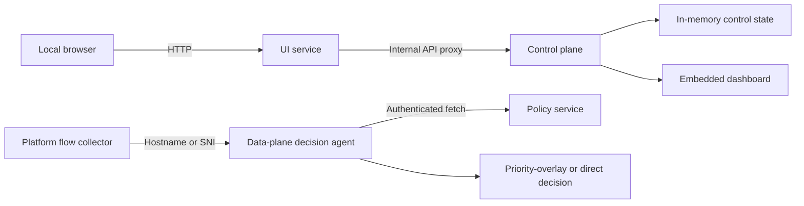

# Design

## Goal

Provide a small, software-only SD-WAN client that gives work traffic priority over ordinary household traffic. The initial prototype focuses on the local control plane and operator experience rather than packet forwarding.

## Architecture



The single Go process uses `net/http` and serves both the embedded dashboard and JSON API. A `sync.RWMutex` protects shared state, allowing concurrent reads while policy updates and route optimization mutate the client state safely.

## Repository Layout

```text
cmd/
    ui-service/                    Browser UI and internal API proxy
    control-plane/                 Dashboard and local control API
        policy-service/              Authenticated policy distribution
    data-plane/
        agent/                       Flow-decision API used by native adapters
    observability/
        metrics-server/              Performance and bandwidth ingestion
internal/
    policy/                        Shared domain matching and policy model
deploy/                          Docker image, Compose stack, and environment template
```

The UI service owns browser presentation and proxies only control-plane API traffic. The control plane owns user-facing configuration and policy distribution but is internal-only in the Compose deployment. The data plane owns flow classification decisions and remains independent from the browser UI. Observability receives measurements and does not participate in routing decisions.

## Policy Model

An application policy has an identifier, category, priority, route, health value, and enabled state. Default work and productivity applications have `High` priority and are enabled. Disabled policies revert to the direct internet path with `Standard` priority.

Route optimization simulates current latency and jitter, derives a score for each available path, selects the best path, and assigns enabled applications to it. The activity feed records the resulting policy event.

## HTTP Interface

`GET /api/state` returns the complete current client state. The three POST actions mutate state:

- `/api/policies/{id}/toggle` changes an individual application policy.
- `/api/optimize` recalculates scores and applies the best route.
- `/api/connection` pauses or resumes the protection state.

The browser dashboard uses these endpoints directly without a frontend build system.

## Data Plane Boundary

The current implementation is intentionally a control-plane simulation. A production client needs a platform-specific data plane that can classify flows and apply real routing decisions. The recommended next components are:

1. A signed domain and application-identification policy feed.
2. OS-specific flow interception and route management.
3. Encrypted gateway tunnels with health probes.
4. Local encrypted storage for device and policy state.
5. Authentication, policy distribution, telemetry, and audit logging.

Those additions should retain the current API as a local observability and user-control surface, while isolating privileged networking code behind a narrow interface.

## Container Services

The Compose deployment separates three processes:

- `control-plane` hosts the local dashboard on loopback port `8080`.
- `policy-service` serves an authenticated, versioned work-application policy snapshot only on the internal Compose network.
- `dataplane-agent` exposes `POST /v1/flows/evaluate` on loopback port `8082`. It fetches and caches policy for 30 seconds, then returns either `priority-overlay` or `direct-internet` for an observed hostname.

All containers run as non-root, have a read-only filesystem, drop Linux capabilities, and use bounded HTTP timeouts. The shared policy token is supplied at runtime through `.env`, never baked into an image.

## Observability

`metrics-server` receives per-application measurements containing baseline and optimized latency and loss, plus bandwidth bytes. It writes them to the separate `timeseries-db` InfluxDB service, which has a fixed 168-hour retention policy. Grafana is a separate service that reads the retained series to show product improvement over the baseline and bandwidth utilization by application such as Zoom, Slack, and Teams.

## Platform Independence

The control, policy, decision, metrics, storage, and visualization services are ordinary Go or containerized services and run unchanged on macOS, Linux/Ubuntu, and Windows. Platform-specific code is limited to the privileged flow collector and route enforcer, which submits normalized hostname or SNI metadata to the common decision API and applies its returned action.

## Production Data Plane

The agent is deliberately a decision service, not a privileged packet interceptor. A real endpoint data plane must be installed as a signed, OS-specific component with narrowly scoped permissions. On Linux it can connect an eBPF or nftables flow collector to the agent; on macOS it should use Network Extension APIs; and on Windows it should use Windows Filtering Platform. That privileged component should enforce the returned action through a managed overlay tunnel, retain a direct-route fail-open policy, and emit audited decisions.

### Linux

The enforcement component should classify flows at the socket or traffic-control layer, associate DNS or TLS SNI metadata with the flow, and ask the local agent for a decision. A `priority-overlay` decision must mark only the matching flow, select the configured WireGuard route table, and retain normal routing for policy-service failures or tunnel health failures. It must run with the least host privileges necessary and keep WireGuard private keys in an OS secret store.

### macOS

The enforcement component must be a signed Packet Tunnel Network Extension. It receives packets through `NEPacketTunnelFlow`, sends flow metadata to the local agent, and forwards only approved priority traffic through an authenticated gateway. Enabling this requires an Apple Developer Team, the Network Extension entitlement, user approval, and a packaged app; containers cannot grant these capabilities.

### Windows

The enforcement component should use Windows Filtering Platform to associate flows with hostname metadata and apply the decision agent's selected tunnel or direct route. It must be signed, installed with the minimum required service privileges, and preserve a direct-route fail-open path when the local agent or overlay is unavailable.