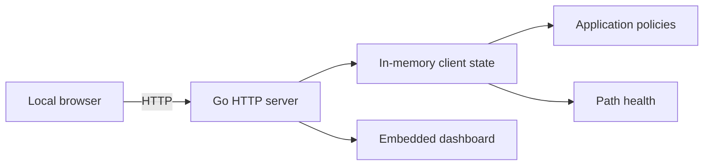

# Design

## Goal

Provide a small, software-only SD-WAN client that gives work traffic priority over ordinary household traffic. The initial prototype focuses on the local control plane and operator experience rather than packet forwarding.

## Architecture

The single Go process uses `net/http` and serves both the embedded dashboard and JSON API. A `sync.RWMutex` protects shared state, allowing concurrent reads while policy updates and route optimization mutate the client state safely.

## Policy Model

An application policy has an identifier, category, priority, route, health value, and enabled state. Default work and productivity applications have `High` priority and are enabled. Disabled policies revert to the direct internet path with `Standard` priority.

Route optimization simulates current latency and jitter, derives a score for each available path, selects the best path, and assigns enabled applications to it. The activity feed records the resulting policy event.

## HTTP Interface

`GET /api/state` returns the complete current client state. The three POST actions mutate state:

- `/api/policies/{id}/toggle` changes an individual application policy.
- `/api/optimize` recalculates scores and applies the best route.
- `/api/connection` pauses or resumes the protection state.

The browser dashboard uses these endpoints directly without a frontend build system.

## Data Plane Boundary

The current implementation is intentionally a control-plane simulation. A production client needs a platform-specific data plane that can classify flows and apply real routing decisions. The recommended next components are:

1. A signed domain and application-identification policy feed.
2. OS-specific flow interception and route management.
3. Encrypted gateway tunnels with health probes.
4. Local encrypted storage for device and policy state.
5. Authentication, policy distribution, telemetry, and audit logging.

Those additions should retain the current API as a local observability and user-control surface, while isolating privileged networking code behind a narrow interface.