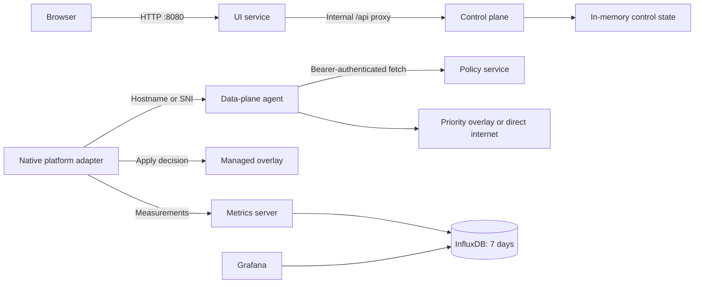
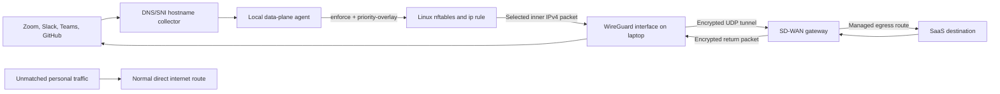
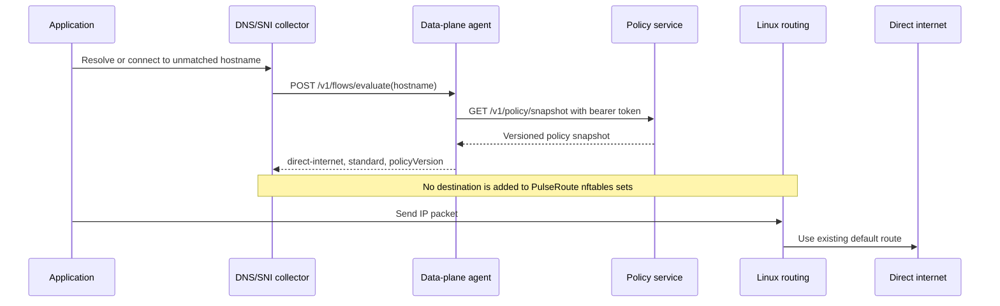
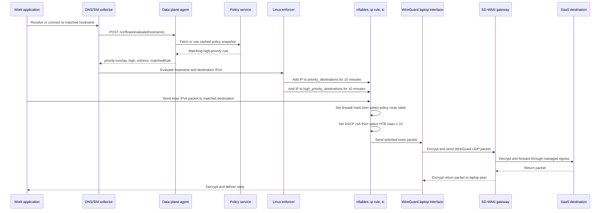
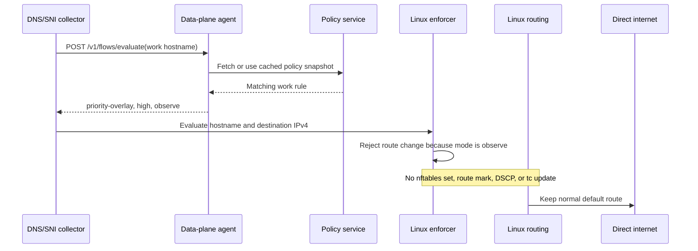
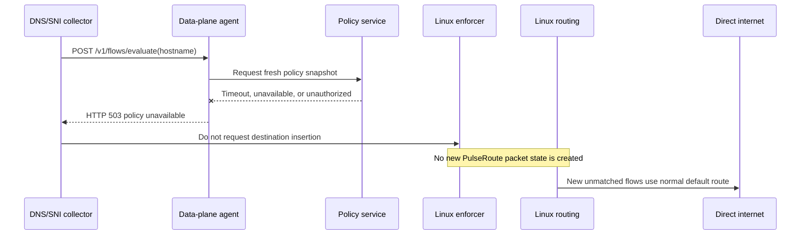
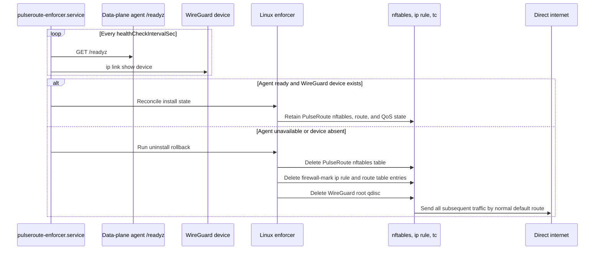
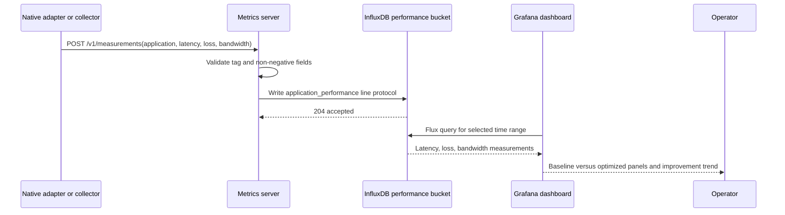

# PulseRoute Design

## Purpose

PulseRoute is a software-defined WAN control and decision prototype for remote devices. It identifies business and productivity traffic, selects a preferred path for it, and exposes routing status to an end user. The repository separates browser presentation, control-plane state, policy distribution, data-plane decisions, and observability so each can evolve independently.

The Go service layer is safe to run locally: it makes and records routing decisions without intercepting host traffic. On Linux, a separately installed, root-owned native enforcer can consume the same data-plane API to apply policy routing and QoS to WireGuard overlay traffic. macOS and Windows enforcement remain platform-specific delivery work.

## Problem It Solves

Remote users often reach work applications through changing home, mobile, and public networks. A corporate VPN or security service such as Cisco AnyConnect or Zscaler remains responsible for identity, secure access, inspection, and corporate routing, but it does not necessarily make per-application decisions based on current path quality. A collaboration call, source-control operation, and personal streaming session can otherwise compete for the same constrained link or follow a path with excessive latency, jitter, or loss.

PulseRoute is an optional, policy-controlled decision layer alongside that approved security client. It maps recognized work destinations to a priority policy, consumes measurements from an authorized device probe or gateway, selects the highest-quality permitted path, and records the resulting baseline versus optimized performance. Personal and unmatched traffic stays on its ordinary internet route. If policy, telemetry, the agent, or the overlay is unavailable, the system fails open to normal routing rather than blocking access.

PulseRoute is not a VPN replacement or a mechanism to bypass corporate controls. It is only deployable where the organization permits split routing or an approved SD-WAN overlay integrated with its existing VPN/SSE policy.

## Goals

- Prioritize recognized work traffic such as Zoom, Slack, Teams, GitHub, Bitbucket, and productivity applications.
- Keep unrelated household traffic on its ordinary internet route.
- Make routing decisions inspectable through the local UI and APIs.
- Run the service layer unchanged on macOS, Linux/Ubuntu, and Windows.
- Retain performance and bandwidth measurements for seven days.
- Fail open: unavailable policy, agent, or overlay components must not block ordinary internet access.

## Non-Goals

- Go services do not configure OS routes, WireGuard peers, VPN tunnels, eBPF, or Windows Filtering Platform rules.
- The Linux enforcer does not create a WireGuard peer, discover application hostnames, or guarantee upstream DSCP treatment. A deployment-managed WireGuard configuration and an authoritative DNS/SNI flow collector remain required.
- Docker containers do not intercept macOS, Windows, or host Linux traffic.
- Control-plane state is in memory and resets on restart.
- The initial policy feed is static Go data, not yet remotely administered or signed.

## Architecture



Only `ui-service`, Grafana, and the local decision and metrics endpoints are published to host loopback by Compose. The control plane and policy service stay internal to the Compose network.

## Repository Layout

```text
cmd/
  ui-service/                       Browser UI and internal API proxy
  control-plane/                    Dashboard control state and APIs
    policy-service/                 Authenticated policy snapshot provider
  data-plane/agent/                 Flow-decision API for native adapters
  observability/metrics-server/     Performance and bandwidth ingestion
internal/policy/                    Shared policy snapshot and hostname matching
deploy/                             Docker image, Compose stack, environment template
native/
  linux/enforcer/                   Root-owned WireGuard route and QoS enforcer
  linux/systemd/                    Fail-open enforcement watchdog unit
  macos/                            Host app and Packet Tunnel Xcode project
CodeWalkThrough.md                  Service and request-flow guide
README.md                           Setup and API reference
```

## Service Responsibilities

### UI Service

`ui-service` serves the dashboard at `GET /` and forwards `/api/*` unchanged to the internal control plane. This lets a browser use simple relative URLs while keeping internal service addresses and control APIs off the host network.

### Control Plane

`control-plane` owns application enablement, selected path, reported path health, and activity history. Its APIs query state, toggle one application, enable all applications, accept a complete timestamped path-measurement cycle, apply the current selection, and pause/resume protection. A device probe or SD-WAN gateway supplies latency, loss, and jitter for every configured path; the control plane scores those values and moves enabled applications to the best path.

### Policy Service

`policy-service` returns a versioned policy snapshot. A policy rule maps an application ID to hostname suffixes. Callers must provide `POLICY_SERVICE_TOKEN` as a bearer token; comparison uses constant-time equality. In production, the policy needs remote administration, signing, version history, and rollback.

### Data-Plane Agent

`dataplane-agent` accepts an observed hostname at `POST /v1/flows/evaluate`. It caches the policy snapshot for 30 seconds. A matched hostname returns `priority-overlay` and high priority; unmatched traffic returns `direct-internet` and standard priority. `DATAPLANE_MODE=observe` reports only. `enforce` permits a platform-native adapter to apply its own routing and QoS behavior; the agent never executes privileged operating-system commands.

### Observability

`metrics-server` receives per-application baseline and optimized latency/loss plus bandwidth bytes. It writes `application_performance` points to InfluxDB. The `timeseries-db` bucket retains data for `168h`. Compose provisions Grafana's Flux datasource and a `PulseRoute Performance` dashboard with baseline versus optimized latency/loss, bandwidth by application, and latency-improvement panels.

## API Contracts

### Control Plane

| Method | Path | Result |
| --- | --- | --- |
| `GET` | `/api/state` | Connection, applications, paths, and activity. |
| `POST` | `/api/policies/{id}/toggle` | Switches one application policy. |
| `POST` | `/api/policies/enable-all` | Enables all applications at high priority. |
| `POST` | `/api/paths/measurements` | Accepts a complete timestamped path-measurement cycle and selects the best path. |
| `POST` | `/api/optimize` | Reapplies the most recently reported path measurements. |
| `POST` | `/api/connection` | Pauses or resumes protection. |

### Data Plane

| Method | Path | Request | Result |
| --- | --- | --- |
| `POST` | `/v1/flows/evaluate` | `{"hostname":"api.github.com"}` | Priority-overlay or direct-internet decision. |

A decision includes `action`, `priority`, optional `matchedRule`, `policyVersion`, and `mode`. The native adapter must use a priority overlay only while it is healthy; a failure falls back to direct internet. On Linux, QoS is eligible only when all three conditions hold: `mode` is `enforce`, `action` is `priority-overlay`, and `priority` is `high`.

### Observability

| Method | Path | Request |
| --- | --- | --- |
| `POST` | `/v1/measurements` | Application, baseline/optimized latency and loss, bandwidth bytes. |

## Security Boundaries

- `POLICY_SERVICE_TOKEN` protects policy snapshot access. It must be a unique runtime secret of at least 32 characters.
- `INFLUXDB_ADMIN_TOKEN` initializes the local database. `GRAFANA_ADMIN_PASSWORD` is a distinct Grafana login secret. Production must use separate, scoped service credentials from a secret manager; neither administrator credential should be used by an application workload.
- Custom Go containers run non-root with a read-only filesystem, `/tmp` tmpfs, dropped Linux capabilities, and `no-new-privileges`.
- UI responses include `X-Content-Type-Options: nosniff` and `X-Frame-Options: DENY`.
- Data-plane and metrics request bodies are size-limited before JSON decoding.
- TLS, device identity, policy signing, persistent audit logs, RBAC, and secret rotation remain production requirements.

## Deployment and Operations

```sh
cp deploy/.env.example .env
docker compose -f deploy/docker-compose.yml up --build
```

The UI runs on `http://localhost:8080`, Grafana on `http://localhost:3000`, and local decision and metrics APIs on `8082` and `8083`. Compose health-gates dependent services: UI waits for control-plane liveness; the agent waits for policy readiness; metrics and Grafana wait for InfluxDB. Run `go test ./...` before packaging changes. The agent's `/readyz` endpoint validates that a policy snapshot is available; metrics `/readyz` validates InfluxDB reachability.

## Platform-Native Enforcement

The Go service layer is portable. Only interception and enforcement differ by OS:

- **Linux/Ubuntu**: the implemented `pulseroute-enforcer` uses nftables destination sets, an output-chain firewall mark, and an `ip rule` plus dedicated route table to steer approved IPv4 destinations through a pre-existing WireGuard device. It configures HTB classes on that device. High-priority overlay decisions are entered in a separate set, receive configured DSCP (`cs5` by default), and select HTB class `1:10`; standard overlay traffic uses the default class. `uninstall` deletes only PulseRoute's nftables table, route rule/table, and root qdisc. The `pulseroute-enforcer.service` watchdog checks local agent readiness and WireGuard device existence; on failure it removes those rules so traffic returns to the normal direct route. The root-owned JSON configuration includes the WireGuard device, route table, firewall mark, link rate, high-priority allocation, DSCP, and watchdog interval. It must not contain WireGuard private keys.
- **macOS**: `PulseRoute.xcodeproj` builds an unsigned host app and embedded Packet Tunnel target. The provider reads `remoteAddress`, `ipv4Address`, `ipv4SubnetMask`, and `agentURL` from managed `providerConfiguration`, refuses incomplete values, and consults the local agent for hostname decisions. It requires an Apple Developer Team, Network Extension entitlement, provisioning, user approval, signing, and notarized packaging before installation. Packet-flow classification and gateway forwarding are not yet implemented.
- **Windows**: a signed least-privileged service uses Windows Filtering Platform to associate flows with hostname metadata, calls the agent, and selects overlay or direct routing.

Linux operators must set WireGuard `PersistentKeepalive` and add gateway-path monitoring: interface existence alone does not prove the overlay peer is reachable. The enforcer accepts IPv4 destinations only; IPv6 policy enforcement is not implemented. Every adapter should begin in observe mode, emit measurements, be canaried to managed devices, and preserve direct internet as the failure path.

### Linux Packet and Tunnel Flow

The WireGuard tunnel is a device-to-gateway transport. It is not an application-specific tunnel and it does not terminate at Zoom, Slack, Teams, GitHub, or any other SaaS provider. The laptop encrypts selected inner IP packets and sends the resulting WireGuard UDP packets to the SD-WAN gateway. The gateway decrypts them and forwards the original packets to the SaaS destination using its managed egress path.



#### Policy Decision to Packet State

1. A hostname collector associates a DNS answer, TLS SNI value, or approved application rule with a destination IP address.
2. The collector calls `POST /v1/flows/evaluate` on the local data-plane agent.
3. The agent returns an auditable decision containing `action`, `priority`, `matchedRule`, `policyVersion`, and `mode`.
4. The Linux enforcer changes kernel packet state only when `mode` is `enforce` and `action` is `priority-overlay`.
5. The enforcer adds the approved IPv4 destination to `inet pulseroute priority_destinations` with a ten-minute expiry. Destinations that also have `priority: high` are added to `high_priority_destinations`.

The expiry limits stale SaaS IP mappings. A production collector must refresh mappings before expiry, remove mappings when policy no longer matches, and avoid routing a shared CDN address through the overlay unless policy explicitly authorizes it.

#### Packet Changes on the Laptop

For a destination in `priority_destinations`, the nftables output route chain applies `firewallMark`. The kernel `ip rule` matches that mark and looks up the configured dedicated route table. That route table sends the inner IPv4 packet to the configured WireGuard device, for example `wg-pulseroute`, rather than the laptop's normal default route.

For a destination in `high_priority_destinations`, the QoS output chain additionally sets the configured DSCP class, `cs5` by default, and selects Linux traffic-control class `1:10`. The enforcer installs an HTB root qdisc on the WireGuard device with:

- Class `1:10`: high-priority work traffic, configured minimum `highPriorityRateMbit`, allowed to borrow up to `linkRateMbit`.
- Class `1:30`: default overlay traffic, configured as the lower scheduling priority.

This scheduling decision is local to the laptop's egress queue. The gateway and intermediate networks may rewrite or ignore DSCP, so PulseRoute does not claim end-to-end QoS. The packet's WireGuard outer UDP encapsulation is encrypted between laptop and gateway; the inner packet is decrypted only at the gateway before normal forwarding.

#### Gateway and Return-Path Requirements

The SD-WAN gateway is outside this repository and must be provisioned separately. It needs a WireGuard peer for the laptop, a tunnel address plan, forwarding enabled, firewall policy, and either source NAT or explicit return routes so replies to selected SaaS flows return through the same tunnel. It must have a managed egress path that is measurably better than the laptop's direct ISP path for the selected services; otherwise the extra tunnel hop can increase latency.

The WireGuard configuration owns endpoint address and port, gateway public key, laptop private key, tunnel address, `AllowedIPs`, and `PersistentKeepalive`. Private keys and gateway credentials stay in root-owned deployment configuration or a secrets system and are never written to the PulseRoute repository or Docker environment.

#### Direct Traffic and Fail-Open Behavior

Traffic that has no matching policy destination receives no PulseRoute firewall mark, no dedicated route-table lookup, and no WireGuard QoS class. It follows the operating system's existing normal default route directly to the internet.

The watchdog checks local data-plane-agent readiness and WireGuard device existence. When either check fails, it removes the PulseRoute nftables table, policy rule, dedicated route table entries, and WireGuard qdisc. This makes the normal direct route the remaining path. Interface existence does not prove gateway reachability, so production deployments also need WireGuard peer handshake checks and active gateway-path health probes before retaining overlay routing.

#### Current Enforcement Boundary

The repository implements explicit Linux destination evaluation and application of nftables, policy-routing, DSCP, and HTB state. It does not yet implement the authoritative DNS/SNI collector, WireGuard peer provisioning, gateway forwarding/NAT, IPv6 split tunneling, or active gateway-path measurement. Those components are required before claiming autonomous per-application production steering.

### Scenario Sequences

The following sequences describe the intended production flow. The collector is a required future component; today an operator or an external collector invokes the Linux enforcer explicitly with a hostname and destination IPv4 address.

#### 1. Unmatched Traffic Uses Direct Internet

This scenario covers personal or unrecognized traffic, such as a streaming, gaming, or household destination that does not match a work policy rule.



The packet receives no PulseRoute firewall mark, DSCP value, or traffic-control class. It does not enter WireGuard and the SD-WAN gateway never sees it.

#### 2. High-Priority Work Traffic Uses the Overlay

This scenario covers a matched work hostname when the agent is in `enforce` mode, for example Zoom, Slack, Teams, or GitHub.



The high-priority DSCP and HTB class are local laptop egress controls. The gateway needs a WireGuard peer, forwarding/firewall policy, and NAT or return routing for the symmetric reply path. The gateway's egress path must be better than direct internet for this route to improve application performance.

#### 3. Matched Work Traffic in Observe Mode

Observe mode is used for rollout validation and telemetry. A policy match is returned but must not change kernel packet state.



This validates policy coverage and decision behavior without sending customer traffic through a new overlay path.

#### 4. Policy or Agent Is Unavailable

The adapter must not create new overlay routing state when it cannot obtain a trustworthy policy decision. Existing overlay state is handled by the watchdog scenario below.



The agent caches a valid policy snapshot for 30 seconds. Within that cache interval it can continue evaluating flows from the last authenticated snapshot; after expiry, unavailable policy produces `503` rather than an untrusted decision.

#### 5. WireGuard or Agent Health Fails Open

The systemd watchdog periodically checks the local agent readiness endpoint and WireGuard device existence. It removes only PulseRoute-owned networking state when either check fails.



This is fail-open, not fail-closed: a control-plane, agent, or local WireGuard-device failure must not block laptop internet access. Gateway reachability needs stronger checks than device existence, such as WireGuard handshake age and active probes, before a production rollout relies on this watchdog alone.

#### 6. Performance Measurement and Dashboarding

The metrics path is independent from packet steering. A native adapter or collector submits measured baseline and optimized values; Grafana displays only the values it receives.



The dashboard does not prove an overlay benefit by itself. Measurements must compare equivalent workloads and time windows, and the adapter must record both direct-path baseline and overlay-path values before any performance claim is made.

## Production Readiness Roadmap

1. Replace static policy data with signed, versioned, remotely managed policies.
2. Add mutual TLS or per-device credentials for services and gateway.
3. Deliver an authenticated, health-checked WireGuard gateway configuration and an authoritative DNS/SNI flow collector for the Linux enforcer.
4. Build, sign, and distribute the macOS Packet Tunnel and Windows Filtering Platform adapters.
5. Add durable state, audit logs, Grafana provisioning, alerts, and dashboards.
6. Add Linux integration tests for policy refresh, WireGuard loss, fail-open, upgrades, rollback, and DSCP/HTB behavior.
7. Add pinned image digests, vulnerability scans, SBOMs, image signing, and CI release artifacts.
