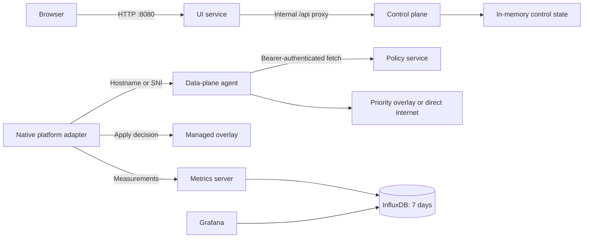

# PulseRoute Design

## Purpose

PulseRoute is a software-defined WAN control and decision prototype for remote devices. It identifies business and productivity traffic, selects a preferred path for it, and exposes routing status to an end user. The repository separates browser presentation, control-plane state, policy distribution, data-plane decisions, and observability so each can evolve independently.

The current implementation is safe to run locally: it makes and records routing decisions but does not intercept host traffic. A platform-native enforcer will consume the same data-plane API for real traffic handling.

## Goals

- Prioritize recognized work traffic such as Zoom, Slack, Teams, GitHub, Bitbucket, and productivity applications.
- Keep unrelated household traffic on its ordinary internet route.
- Make routing decisions inspectable through the local UI and APIs.
- Run the service layer unchanged on macOS, Linux/Ubuntu, and Windows.
- Retain performance and bandwidth measurements for seven days.
- Fail open: unavailable policy, agent, or overlay components must not block ordinary internet access.

## Non-Goals

- Go services do not configure OS routes, WireGuard, VPN tunnels, QoS, eBPF, nftables, or Windows Filtering Platform rules.
- Docker containers do not intercept macOS, Windows, or host Linux traffic.
- Control-plane state is in memory and resets on restart.
- The initial policy feed is static Go data, not yet remotely administered or signed.

## Architecture



Only `ui-service`, Grafana, and the local decision and metrics endpoints are published to host loopback by Compose. The control plane and policy service stay internal to the Compose network.

## Repository Layout

```text
cmd/
  ui-service/                       Browser UI and internal API proxy
  control-plane/                    Dashboard control state and APIs
    policy-service/                 Authenticated policy snapshot provider
  data-plane/agent/                 Flow-decision API for native adapters
  observability/metrics-server/     Performance and bandwidth ingestion
internal/policy/                    Shared policy snapshot and hostname matching
deploy/                             Docker image, Compose stack, environment template
CodeWalkThrough.md                  Service and request-flow guide
README.md                           Setup and API reference
```

## Service Responsibilities

### UI Service

`ui-service` serves the dashboard at `GET /` and forwards `/api/*` unchanged to the internal control plane. This lets a browser use simple relative URLs while keeping internal service addresses and control APIs off the host network.

### Control Plane

`control-plane` owns application enablement, selected path, simulated path health, and activity history. Its APIs query state, toggle one application, enable all applications, optimize paths, and pause/resume protection. Optimization currently changes synthetic latency and jitter values, selects the highest score, and moves enabled applications to that path.

### Policy Service

`policy-service` returns a versioned policy snapshot. A policy rule maps an application ID to hostname suffixes. Callers must provide `POLICY_SERVICE_TOKEN` as a bearer token; comparison uses constant-time equality. In production, the policy needs remote administration, signing, version history, and rollback.

### Data-Plane Agent

`dataplane-agent` accepts an observed hostname at `POST /v1/flows/evaluate`. It caches the policy snapshot for 30 seconds. A matched hostname returns `priority-overlay` and high priority; unmatched traffic returns `direct-internet` and standard priority. `DATAPLANE_MODE=observe` reports only; `enforce` tells a native adapter it may act but does not change host routing itself.

### Observability

`metrics-server` receives per-application baseline and optimized latency/loss plus bandwidth bytes. It writes `application_performance` points to InfluxDB. The `timeseries-db` bucket retains data for `168h`, and Grafana reads that history for improvement and utilization panels. Compose deploys Grafana but dashboard/datasource provisioning is still needed before operations rollout.

## API Contracts

### Control Plane

| Method | Path | Result |
| --- | --- | --- |
| `GET` | `/api/state` | Connection, applications, paths, and activity. |
| `POST` | `/api/policies/{id}/toggle` | Switches one application policy. |
| `POST` | `/api/policies/enable-all` | Enables all applications at high priority. |
| `POST` | `/api/optimize` | Selects the best simulated path. |
| `POST` | `/api/connection` | Pauses or resumes protection. |

### Data Plane

| Method | Path | Request | Result |
| --- | --- | --- |
| `POST` | `/v1/flows/evaluate` | `{"hostname":"api.github.com"}` | Priority-overlay or direct-internet decision. |

A decision includes `action`, `priority`, optional `matchedRule`, `policyVersion`, and `mode`. The native adapter must use a priority overlay only while it is healthy; a failure falls back to direct internet.

### Observability

| Method | Path | Request |
| --- | --- | --- |
| `POST` | `/v1/measurements` | Application, baseline/optimized latency and loss, bandwidth bytes. |

## Security Boundaries

- `POLICY_SERVICE_TOKEN` protects policy snapshot access. It must be a unique runtime secret of at least 32 characters.
- `INFLUXDB_ADMIN_TOKEN` initializes the local database and Grafana. Production must use separate, scoped service credentials from a secret manager.
- Custom Go containers run non-root with a read-only filesystem, `/tmp` tmpfs, dropped Linux capabilities, and `no-new-privileges`.
- UI responses include `X-Content-Type-Options: nosniff` and `X-Frame-Options: DENY`.
- Data-plane and metrics request bodies are size-limited before JSON decoding.
- TLS, device identity, policy signing, persistent audit logs, RBAC, and secret rotation remain production requirements.

## Deployment and Operations

```sh
cp deploy/.env.example .env
docker compose -f deploy/docker-compose.yml up --build
```

The UI runs on `http://localhost:8080`, Grafana on `http://localhost:3000`, and local decision and metrics APIs on `8082` and `8083`. Run `go test ./...` before packaging changes. Health endpoints exist for UI, policy, data-plane, and metrics services.

## Platform-Native Enforcement

The Go service layer is portable. Only interception and enforcement differ by OS:

- **Linux/Ubuntu**: a managed root component uses eBPF or nftables to classify flows, calls the agent, marks overlay traffic, and selects a WireGuard route table. It must retain a direct default route and remove priority rules if the tunnel fails.
- **macOS**: a signed Packet Tunnel Network Extension receives packets with `NEPacketTunnelFlow`, consults the local agent, and forwards approved traffic over the overlay. It requires Apple Network Extension entitlement, provisioning, user approval, and notarized packaging.
- **Windows**: a signed least-privileged service uses Windows Filtering Platform to associate flows with hostname metadata, calls the agent, and selects overlay or direct routing.

Every adapter should begin in observe mode, emit measurements, be canaried to managed devices, and preserve direct internet as the failure path.

## Production Readiness Roadmap

1. Replace static policy data with signed, versioned, remotely managed policies.
2. Add mutual TLS or per-device credentials for services and gateway.
3. Build native adapters and a health-checked authenticated overlay gateway.
4. Add durable state, audit logs, Grafana provisioning, alerts, and dashboards.
5. Add integration tests for policy refresh, tunnel loss, fail-open, upgrades, and rollback.
6. Add pinned image digests, vulnerability scans, SBOMs, image signing, and CI release artifacts.