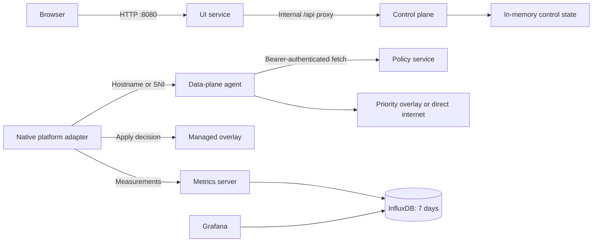
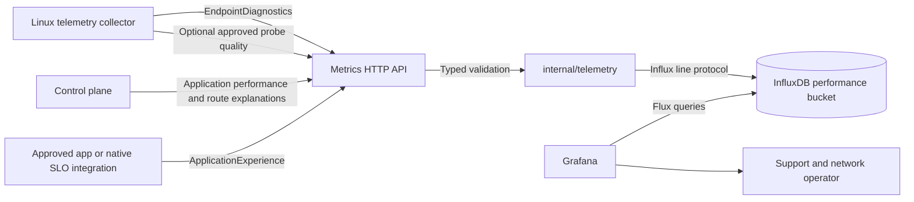
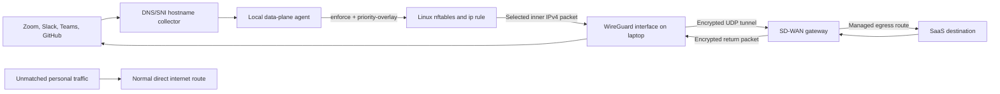
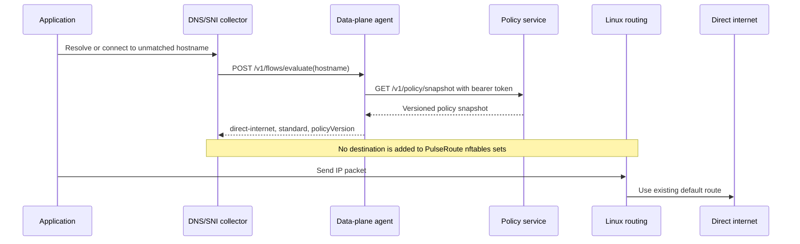
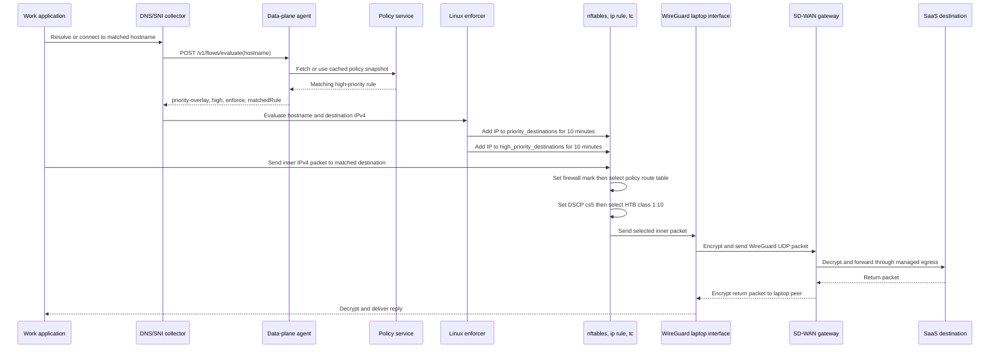
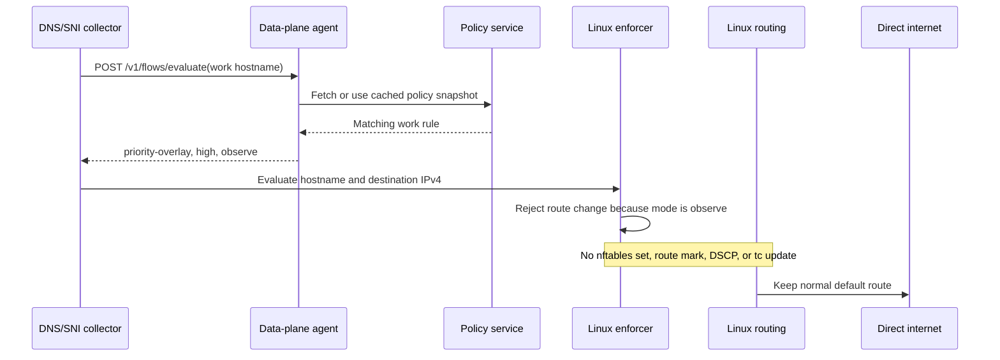
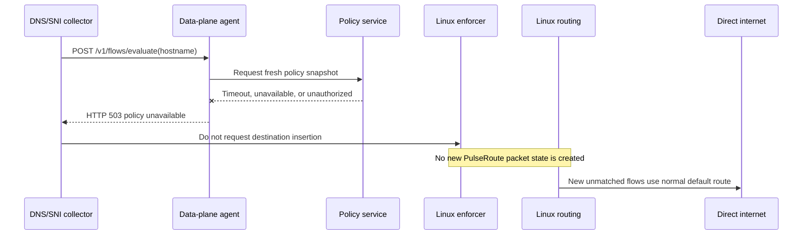
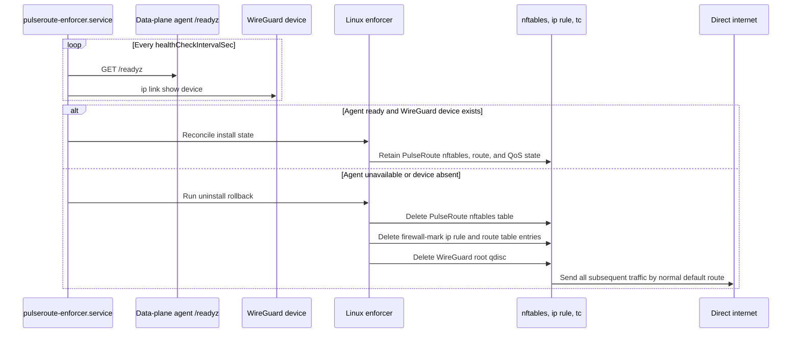
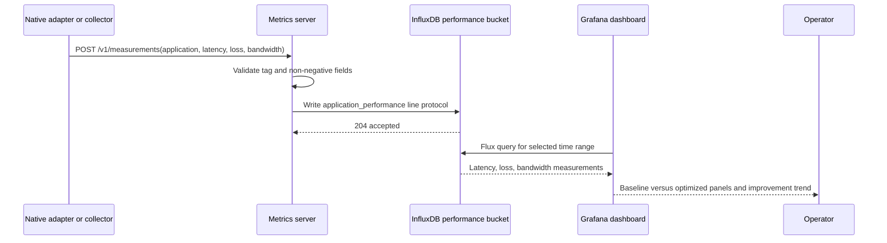
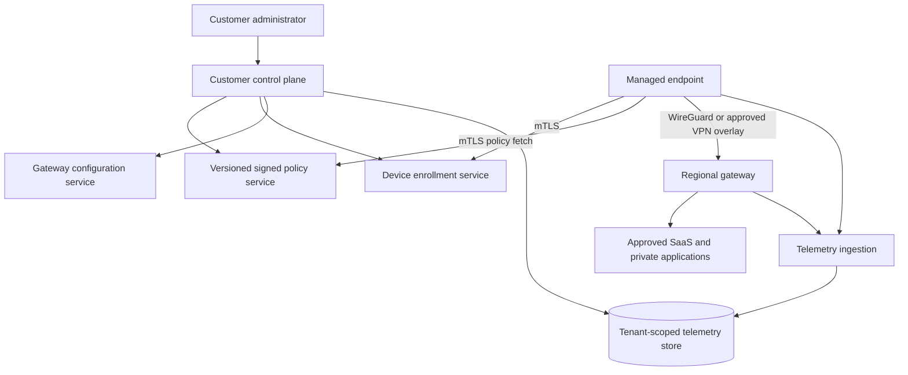

# PulseRoute Design

## Purpose

PulseRoute is a software-defined WAN control and decision prototype for remote devices. It identifies business and productivity traffic, selects a preferred path for it, and exposes routing status to an end user. The repository separates browser presentation, control-plane state, policy distribution, data-plane decisions, and observability so each can evolve independently.

The Go service layer is safe to run locally: it makes and records routing decisions without intercepting host traffic. On Linux, a separately installed, root-owned native enforcer can consume the same data-plane API to apply policy routing and QoS to WireGuard overlay traffic. macOS and Windows enforcement remain platform-specific delivery work.

## Problem It Solves

Remote users often reach work applications through changing home, mobile, and public networks. A corporate VPN or security service such as Cisco AnyConnect or Zscaler remains responsible for identity, secure access, inspection, and corporate routing, but it does not necessarily make per-application decisions based on current path quality. A collaboration call, source-control operation, and personal streaming session can otherwise compete for the same constrained link or follow a path with excessive latency, jitter, or loss.

PulseRoute is an optional, policy-controlled decision layer alongside that approved security client. It maps recognized work destinations to a priority policy, consumes measurements from an authorized device probe or gateway, selects the highest-quality permitted path, and records the resulting baseline versus optimized performance. Personal and unmatched traffic stays on its ordinary internet route only where the organization's VPN/SSE policy permits local breakout. If policy, telemetry, the agent, or the overlay is unavailable, the current native implementation fails open to normal routing rather than blocking access.

PulseRoute is not a VPN replacement or a mechanism to bypass corporate controls. It is only deployable where the organization permits split routing or an approved SD-WAN overlay integrated with its existing VPN/SSE policy.

## Corporate VPN Integration

PulseRoute has two mutually exclusive organization-selected deployment models:

1. **Existing corporate VPN/SSE:** The existing AnyConnect, Zscaler, GlobalProtect, or comparable client remains responsible for tunnel establishment and corporate routing. PulseRoute may observe the connection and apply only organization-approved local QoS or routing behavior; it cannot create a path that escapes a full-tunnel VPN.
2. **Organization-managed PulseRoute overlay:** The organization provisions device identity, WireGuard or IPsec tunnels, gateway forwarding, egress controls, and logging. The overlay is an organization-approved VPN for eligible traffic, not a consumer VPN or a bypass around security controls.

`direct-internet` is a policy result only for traffic that the organization has explicitly approved for local breakout. In a full-tunnel deployment, the native adapter must retain the corporate VPN path for protected work traffic. The current Linux adapter is intentionally fail-open and therefore cannot enforce a tunnel-only, fail-closed policy.

## Goals

- Prioritize recognized work traffic such as Zoom, Slack, Teams, GitHub, Bitbucket, and productivity applications.
- Keep unrelated household traffic on its ordinary internet route.
- Make routing decisions inspectable through the local UI and APIs.
- Run the service layer unchanged on macOS, Linux/Ubuntu, and Windows.
- Retain performance and bandwidth measurements for seven days.
- Fail open: unavailable policy, agent, or overlay components must not block ordinary internet access.

## Non-Goals

- Go services do not configure OS routes, WireGuard peers, VPN tunnels, eBPF, or Windows Filtering Platform rules.
- The Linux enforcer does not create a WireGuard peer, discover application hostnames, or guarantee upstream DSCP treatment. A deployment-managed WireGuard configuration and an authoritative DNS/SNI flow collector remain required.
- Docker containers do not intercept macOS, Windows, or host Linux traffic.
- Control-plane state is in memory and resets on restart.
- The initial policy feed is static Go data, not yet remotely administered or signed.

## Architecture



Only `ui-service`, Grafana, and the local decision and metrics endpoints are published to host loopback by Compose. The control plane and policy service stay internal to the Compose network.

## Repository Layout

```text
cmd/
  ui-service/                       Browser UI and internal API proxy
  control-plane/                    Dashboard control state and APIs
    policy-service/                 Authenticated policy snapshot provider
  data-plane/agent/                 Flow-decision API for native adapters
  observability/metrics-server/     Metrics composition root and server lifecycle
internal/policy/                    Shared policy snapshot and hostname matching
internal/telemetry/                 Typed models, validation, HTTP API, and InfluxDB writer
deploy/                             Docker image, Compose stack, environment template
native/
  linux/enforcer/                   Root-owned WireGuard route and QoS enforcer
  linux/telemetry/                  Observe-only endpoint health collector
  linux/systemd/                    Fail-open enforcement watchdog unit
  macos/                            Host app and Packet Tunnel Xcode project
CodeWalkThrough.md                  Service and request-flow guide
README.md                           Setup and API reference
```

## Service Responsibilities

### UI Service

`ui-service` serves the dashboard at `GET /` and forwards `/api/*` unchanged to the internal control plane. This lets a browser use simple relative URLs while keeping internal service addresses and control APIs off the host network.

### Control Plane

`control-plane` owns application enablement, selected path, reported path health, and activity history. Its APIs query state, toggle one application, enable all applications, accept a complete timestamped path-measurement cycle, apply the current selection, and pause/resume protection. A device probe or SD-WAN gateway supplies latency, loss, and jitter for every configured path; the control plane scores those values and moves enabled applications to the best path.

### Policy Service

`policy-service` returns a versioned policy snapshot. A policy rule maps an application ID to hostname suffixes. Callers must provide `POLICY_SERVICE_TOKEN` as a bearer token; comparison uses constant-time equality. In production, the policy needs remote administration, signing, version history, and rollback.

### Data-Plane Agent

`dataplane-agent` accepts an observed hostname at `POST /v1/flows/evaluate`. It caches the policy snapshot for 30 seconds. A matched hostname returns `priority-overlay` and high priority; unmatched traffic returns `direct-internet` and standard priority. `DATAPLANE_MODE=observe` reports only. `enforce` permits a platform-native adapter to apply its own routing and QoS behavior; the agent never executes privileged operating-system commands.

### Observability

`cmd/observability/metrics-server` is deliberately a thin composition root. It reads InfluxDB configuration, creates `internal/telemetry.InfluxWriter`, and starts an HTTP server. `internal/telemetry` owns the typed telemetry models, validation, HTTP request decoding, InfluxDB line-protocol serialization, storage readiness checks, and tests. This keeps native collectors and future platform adapters on one contract rather than duplicating JSON schemas or storage code in each executable.

The metrics API accepts five independent measurements: existing application path performance, endpoint quality, endpoint diagnostics, application SLO outcomes, and route-decision explanations. All writes are telemetry only; no metrics endpoint can alter policies, routes, WireGuard, QoS, VPN state, or a native adapter. The `timeseries-db` bucket retains data for `168h`. Compose provisions Grafana's Flux datasource and the `PulseRoute Performance` dashboard, which includes baseline/optimized application performance, endpoint VPN and quality views, SLO before/after/target values, avoided incidents, and candidate-path decision scores.

## API Contracts

### Control Plane

| Method | Path | Result |
| --- | --- | --- |
| `GET` | `/api/state` | Connection, applications, paths, and activity. |
| `POST` | `/api/policies/{id}/toggle` | Switches one application policy. |
| `POST` | `/api/policies/enable-all` | Enables all applications at high priority. |
| `POST` | `/api/paths/measurements` | Accepts a complete timestamped path-measurement cycle and selects the best path. |
| `POST` | `/api/optimize` | Reapplies the most recently reported path measurements. |
| `POST` | `/api/connection` | Pauses or resumes protection. |

### Data Plane

| Method | Path | Request | Result |
| --- | --- | --- |
| `POST` | `/v1/flows/evaluate` | `{"hostname":"api.github.com"}` | Priority-overlay or direct-internet decision. |

A decision includes `action`, `priority`, optional `matchedRule`, `policyVersion`, and `mode`. The native adapter must use a priority overlay only while it is healthy; a failure falls back to direct internet. On Linux, QoS is eligible only when all three conditions hold: `mode` is `enforce`, `action` is `priority-overlay`, and `priority` is `high`.

### Observability

| Method | Path | Request |
| --- | --- | --- |
| `POST` | `/v1/measurements` | Application, baseline/optimized latency and loss, bandwidth bytes. |
| `POST` | `/v1/endpoint-telemetry` | Device/network/VPN state, aggregate path quality, interface byte counters. |
| `POST` | `/v1/endpoint-diagnostics` | Coarse active-interface, route, optional probe, Wi-Fi signal, and host resource state. |
| `POST` | `/v1/application-experience` | Supported application SLO baseline, optimized, target, and avoided-incident state. |
| `POST` | `/v1/route-decisions` | Policy reason/result/rollback state and one selected path among candidate paths. |

All telemetry writes return `202 Accepted` only after InfluxDB returns `204 No Content`. Invalid JSON, invalid tags, invalid quality ranges, unsupported SLO names, or ambiguous route decisions return `400 Bad Request`. Storage or readiness failures return `503 Service Unavailable`; callers own retry behavior. Request bodies are bounded to 16 KiB except route decisions, which allow 64 KiB for up to eight candidate paths.

## Endpoint Experience Telemetry

### Design Intent

Endpoint experience telemetry is an **observe-only** diagnostic plane. It answers: “Was a supported work application measurably better after the control plane chose a path, and what local endpoint condition or candidate comparison explains that result?” It does not inspect application payloads, capture browsing history, or make enforcement decisions. The existing Linux enforcer remains the only native component capable of changing Linux packet state, and it remains separately installed, root-owned, and gated by `DATAPLANE_MODE=enforce`.

The feature is intentionally staged:

1. A collector records local health metadata and optional approved-probe results.
2. The control plane records the candidate paths and policy reason after it accepts a full path-measurement cycle.
3. An approved native or application-specific integration can submit a supported application SLO outcome.
4. Grafana joins the time series by time, device, application, and the non-indexed decision correlation field for investigation.
5. Operators review the evidence before a separate approved enforcement rollout changes traffic behavior.

No application-specific SLO is fabricated by the control plane. Zoom/Teams/Git/Slack integrations must submit real measurements from an authorized source. This preserves the distinction between a routing decision, an endpoint probe, and an application experience claim.

### Component and Data Flow



`internal/telemetry` is the contract boundary. It defines models, validates data before serialization, provides the `net/http` handler, and persists accepted points through `InfluxWriter`. The metrics command does not own schemas or line protocol. The Linux collector imports the shared endpoint models, serializes them as JSON, and sends them to the loopback metrics API; it does not need InfluxDB credentials.

The control plane emits route explanations only after a complete measurement cycle is validated and a best path is selected. It sends an application performance record and a separate route-decision record for every active application. Metrics delivery runs after the state lock is released and does not delay route selection. Failure to publish telemetry is logged; it cannot reverse, block, or alter the selected control-plane route.

### Measurement Contracts and Influx Schema

| Measurement | Tags | Fields | Producer | Purpose |
| --- | --- | --- | --- | --- |
| `application_performance` | `application` | Baseline/optimized latency and loss, bandwidth bytes | Control plane or approved adapter | Existing path-performance comparison. |
| `endpoint_telemetry` | `device_id`, `network_type`, `vpn_provider` | VPN state, latency, jitter, loss, receive/transmit bytes | Linux collector with optional ICMP probe | Endpoint quality and VPN trend. |
| `endpoint_diagnostics` | `device_id`, `network_type`, `active_interface`, `vpn_provider` | Interface change, default route, optional DNS/TLS, CPU load, memory, optional Wi-Fi dBm | Linux collector | Support triage for endpoint conditions. |
| `application_experience` | `device_id`, `application`, `slo` | Baseline, optimized, target, avoided incident, decision ID | Approved application/native integration | SLO evidence before and after a decision. |
| `route_decision` | `device_id`, `application`, `destination_class`, `policy_id`, `candidate_path` | Latency, jitter, loss, score, selected, decision ID, reason, result, rollback event | Control plane | Explain why one candidate won or a rollback occurred. |

`decision_id`, `reason`, `result`, and `rollback_event` are InfluxDB fields, not tags. Decision IDs are high-cardinality by nature; using them as tags would create an unbounded series count. A single route-decision request creates one correlated Influx point per candidate path, all with the same timestamp and decision ID. Validation requires between one and eight candidates and exactly one `selected: true` value.

Supported SLO names are explicitly allowlisted: `zoom_jitter_ms`, `zoom_loss_pct`, `teams_rtt_ms`, `git_transfer_duration_ms`, `github_transfer_duration_ms`, and `slack_reconnect_count`. The allowlist prevents arbitrary metric dimensions and makes alerts and Grafana units reviewable. Adding an SLO requires a source implementation, validation change, dashboard treatment, and documentation update.

### Linux Collector Operation

`native/linux/telemetry` builds `pulseroute-telemetry`, a Linux-only command with `once` and `watch` modes. It requires a stable managed `--device-id`, an administrator-supplied `--vpn-provider`, and a positive watch interval. Its default sink is `http://127.0.0.1:8083`, so endpoint data remains local to the host’s deployed PulseRoute stack before InfluxDB persistence.

For each collection cycle, the collector reads the IPv4 default interface from `/proc/net/route`, derives only a coarse transport category, checks for a local VPN interface prefix, and reads aggregate load and available memory from procfs. It can optionally read Wi-Fi dBm through `iw` but never reads SSID, BSSID, channel, access-point identity, carrier identity, gateway address, or full route-table contents. Interface byte counters come from `/sys/class/net/<interface>/statistics` and are aggregate counters, not packet or flow samples.

DNS, TLS, and ICMP probes are disabled unless the operator supplies `--dns-host`, `--tls-host`, or `--probe-host`. The configured target names remain local command configuration and are never included in the payload or persisted to InfluxDB. DNS produces only a boolean resolver result; TLS produces only a boolean TLS 1.2-or-newer handshake result; ICMP produces aggregate loss, average latency, and population-standard-deviation jitter from three packets. A fully lost ICMP probe is valid telemetry with `100%` loss. The collector never invokes the enforcer, changes routes, changes QoS, creates a tunnel, captures packets, or parses DNS/SNI application traffic.

### Privacy and Security Boundary

Collected and persisted metadata is intentionally limited to opaque device ID, coarse network type, interface name, VPN provider and availability, aggregate resource state, optional Wi-Fi signal strength, approved-probe booleans and aggregates, route-decision metadata, and approved application/SLO identifiers. The system does **not** collect or persist packet payloads, URLs, hostnames, DNS query history, destination history, SSIDs, BSSIDs, Wi-Fi channels, MAC addresses, gateway addresses, IP route entries, application content, process names, commands, keystrokes, or user activity.

The metrics API validates all tag values against InfluxDB line-protocol separators, bounds string field values, bounds loss to 0 through 100, bounds Wi-Fi signal to plausible negative dBm values, and rejects negative counters or quality values. Native collector subprocesses use explicit arguments without a shell. Metrics endpoint health returns generic failures and never exposes backend credentials. In production, the loopback API must be protected by endpoint identity or mutually authenticated local IPC, and InfluxDB must use a scoped write token rather than the bootstrap administrator token.

### Failure and Rollout Behavior

Telemetry is non-blocking and fail-open. If InfluxDB is unavailable, the metrics API returns `503`; native collectors report the failure and retry on their next watch interval, while the control plane logs the failure and retains its already-selected state. A collector outage, malformed telemetry record, optional-probe failure, or Grafana outage cannot alter an endpoint route or disable ordinary internet access.

Deployment should begin with a small managed cohort in `DATAPLANE_MODE=observe`, with no Linux enforcer installed. Operators should first verify collection rate, device identity quality, privacy review, metric completeness, Influx retention, dashboard usefulness, and support workflow. Only after SLO evidence, controlled gateway health checks, device enrollment, and rollback validation are available should a separately approved cohort move to native enforce mode. The telemetry collector does not become an enforcement prerequisite.

## Security Boundaries

- `POLICY_SERVICE_TOKEN` protects policy snapshot access. It must be a unique runtime secret of at least 32 characters.
- `INFLUXDB_ADMIN_TOKEN` initializes the local database. `GRAFANA_ADMIN_PASSWORD` is a distinct Grafana login secret. Production must use separate, scoped service credentials from a secret manager; neither administrator credential should be used by an application workload.
- Custom Go containers run non-root with a read-only filesystem, `/tmp` tmpfs, dropped Linux capabilities, and `no-new-privileges`.
- UI responses include `X-Content-Type-Options: nosniff` and `X-Frame-Options: DENY`.
- Data-plane and metrics request bodies are size-limited before JSON decoding.
- Endpoint diagnostics are metadata-only; approved probe targets remain local collector configuration and are not persisted.
- Route-decision correlation IDs are storage fields rather than tags to prevent high-cardinality InfluxDB series growth.
- TLS, device identity, policy signing, persistent audit logs, RBAC, and secret rotation remain production requirements.

## Deployment and Operations

```sh
cp deploy/.env.example .env
docker compose -f deploy/docker-compose.yml up --build
```

The UI runs on `http://localhost:8080`, Grafana on `http://localhost:3000`, and local decision and metrics APIs on `8082` and `8083`. Compose health-gates dependent services: UI waits for control-plane liveness; the agent waits for policy readiness; metrics and Grafana wait for InfluxDB. Run `go test ./...` before packaging changes. The agent's `/readyz` endpoint validates that a policy snapshot is available; metrics `/readyz` validates InfluxDB reachability.

## Platform-Native Enforcement

The Go service layer is portable. Only interception and enforcement differ by OS:

- **Linux/Ubuntu**: the implemented `pulseroute-enforcer` uses nftables destination sets, an output-chain firewall mark, and an `ip rule` plus dedicated route table to steer approved IPv4 destinations through a pre-existing WireGuard device. It configures HTB classes on that device. High-priority overlay decisions are entered in a separate set, receive configured DSCP (`cs5` by default), and select HTB class `1:10`; standard overlay traffic uses the default class. `uninstall` deletes only PulseRoute's nftables table, route rule/table, and root qdisc. The `pulseroute-enforcer.service` watchdog checks local agent readiness and WireGuard device existence; on failure it removes those rules so traffic returns to the normal direct route. The root-owned JSON configuration includes the WireGuard device, route table, firewall mark, link rate, high-priority allocation, DSCP, and watchdog interval. It must not contain WireGuard private keys.
- **macOS**: `PulseRoute.xcodeproj` builds an unsigned host app and embedded Packet Tunnel target. The provider reads `remoteAddress`, `ipv4Address`, `ipv4SubnetMask`, and `agentURL` from managed `providerConfiguration`, refuses incomplete values, and consults the local agent for hostname decisions. It requires an Apple Developer Team, Network Extension entitlement, provisioning, user approval, signing, and notarized packaging before installation. Packet-flow classification and gateway forwarding are not yet implemented.
- **Windows**: a signed least-privileged service uses Windows Filtering Platform to associate flows with hostname metadata, calls the agent, and selects overlay or direct routing.

Linux operators must set WireGuard `PersistentKeepalive` and add gateway-path monitoring: interface existence alone does not prove the overlay peer is reachable. The enforcer accepts IPv4 destinations only; IPv6 policy enforcement is not implemented. Every adapter should begin in observe mode, emit measurements, be canaried to managed devices, and preserve direct internet as the failure path.

### Linux Packet and Tunnel Flow

The WireGuard tunnel is a device-to-gateway transport. It is not an application-specific tunnel and it does not terminate at Zoom, Slack, Teams, GitHub, or any other SaaS provider. The laptop encrypts selected inner IP packets and sends the resulting WireGuard UDP packets to the SD-WAN gateway. The gateway decrypts them and forwards the original packets to the SaaS destination using its managed egress path.



#### Policy Decision to Packet State

1. A hostname collector associates a DNS answer, TLS SNI value, or approved application rule with a destination IP address.
2. The collector calls `POST /v1/flows/evaluate` on the local data-plane agent.
3. The agent returns an auditable decision containing `action`, `priority`, `matchedRule`, `policyVersion`, and `mode`.
4. The Linux enforcer changes kernel packet state only when `mode` is `enforce` and `action` is `priority-overlay`.
5. The enforcer adds the approved IPv4 destination to `inet pulseroute priority_destinations` with a ten-minute expiry. Destinations that also have `priority: high` are added to `high_priority_destinations`.

The expiry limits stale SaaS IP mappings. A production collector must refresh mappings before expiry, remove mappings when policy no longer matches, and avoid routing a shared CDN address through the overlay unless policy explicitly authorizes it.

#### Packet Changes on the Laptop

For a destination in `priority_destinations`, the nftables output route chain applies `firewallMark`. The kernel `ip rule` matches that mark and looks up the configured dedicated route table. That route table sends the inner IPv4 packet to the configured WireGuard device, for example `wg-pulseroute`, rather than the laptop's normal default route.

For a destination in `high_priority_destinations`, the QoS output chain additionally sets the configured DSCP class, `cs5` by default, and selects Linux traffic-control class `1:10`. The enforcer installs an HTB root qdisc on the WireGuard device with:

- Class `1:10`: high-priority work traffic, configured minimum `highPriorityRateMbit`, allowed to borrow up to `linkRateMbit`.
- Class `1:30`: default overlay traffic, configured as the lower scheduling priority.

This scheduling decision is local to the laptop's egress queue. The gateway and intermediate networks may rewrite or ignore DSCP, so PulseRoute does not claim end-to-end QoS. The packet's WireGuard outer UDP encapsulation is encrypted between laptop and gateway; the inner packet is decrypted only at the gateway before normal forwarding.

#### Gateway and Return-Path Requirements

The SD-WAN gateway is outside this repository and must be provisioned separately. It needs a WireGuard peer for the laptop, a tunnel address plan, forwarding enabled, firewall policy, and either source NAT or explicit return routes so replies to selected SaaS flows return through the same tunnel. It must have a managed egress path that is measurably better than the laptop's direct ISP path for the selected services; otherwise the extra tunnel hop can increase latency.

The WireGuard configuration owns endpoint address and port, gateway public key, laptop private key, tunnel address, `AllowedIPs`, and `PersistentKeepalive`. Private keys and gateway credentials stay in root-owned deployment configuration or a secrets system and are never written to the PulseRoute repository or Docker environment.

#### Direct Traffic and Fail-Open Behavior

Traffic that has no matching policy destination receives no PulseRoute firewall mark, no dedicated route-table lookup, and no WireGuard QoS class. It follows the operating system's existing normal default route directly to the internet.

The watchdog checks local data-plane-agent readiness and WireGuard device existence. When either check fails, it removes the PulseRoute nftables table, policy rule, dedicated route table entries, and WireGuard qdisc. This makes the normal direct route the remaining path. Interface existence does not prove gateway reachability, so production deployments also need WireGuard peer handshake checks and active gateway-path health probes before retaining overlay routing.

#### Current Enforcement Boundary

The repository implements explicit Linux destination evaluation and application of nftables, policy-routing, DSCP, and HTB state. It does not yet implement the authoritative DNS/SNI collector, WireGuard peer provisioning, gateway forwarding/NAT, IPv6 split tunneling, or active gateway-path measurement. Those components are required before claiming autonomous per-application production steering.

### Scenario Sequences

The following sequences describe the intended production flow. The collector is a required future component; today an operator or an external collector invokes the Linux enforcer explicitly with a hostname and destination IPv4 address.

#### 1. Unmatched Traffic Uses Direct Internet

This scenario covers personal or unrecognized traffic, such as a streaming, gaming, or household destination that does not match a work policy rule.



The packet receives no PulseRoute firewall mark, DSCP value, or traffic-control class. It does not enter WireGuard and the SD-WAN gateway never sees it.

#### 2. High-Priority Work Traffic Uses the Overlay

This scenario covers a matched work hostname when the agent is in `enforce` mode, for example Zoom, Slack, Teams, or GitHub.



The high-priority DSCP and HTB class are local laptop egress controls. The gateway needs a WireGuard peer, forwarding/firewall policy, and NAT or return routing for the symmetric reply path. The gateway's egress path must be better than direct internet for this route to improve application performance.

#### 3. Matched Work Traffic in Observe Mode

Observe mode is used for rollout validation and telemetry. A policy match is returned but must not change kernel packet state.



This validates policy coverage and decision behavior without sending customer traffic through a new overlay path.

#### 4. Policy or Agent Is Unavailable

The adapter must not create new overlay routing state when it cannot obtain a trustworthy policy decision. Existing overlay state is handled by the watchdog scenario below.



The agent caches a valid policy snapshot for 30 seconds. Within that cache interval it can continue evaluating flows from the last authenticated snapshot; after expiry, unavailable policy produces `503` rather than an untrusted decision.

#### 5. WireGuard or Agent Health Fails Open

The systemd watchdog periodically checks the local agent readiness endpoint and WireGuard device existence. It removes only PulseRoute-owned networking state when either check fails.



This is fail-open, not fail-closed: a control-plane, agent, or local WireGuard-device failure must not block laptop internet access. Gateway reachability needs stronger checks than device existence, such as WireGuard handshake age and active probes, before a production rollout relies on this watchdog alone.

#### 6. Performance Measurement and Dashboarding

The metrics path is independent from packet steering. A native adapter or collector submits measured baseline and optimized values; Grafana displays only the values it receives.



The dashboard does not prove an overlay benefit by itself. Measurements must compare equivalent workloads and time windows, and the adapter must record both direct-path baseline and overlay-path values before any performance claim is made.

## Production Target Architecture

This section describes the target architecture required to operate PulseRoute as a paid, organization-managed service. It is a design target, not a statement that the components below are implemented in this repository. The current implementation remains a Linux-first prototype with a local, in-memory control plane and a fail-open enforcer.

The production service has three administrative planes with deliberately separate trust boundaries:

| Plane | Responsibility | Trust boundary |
| --- | --- | --- |
| Endpoint plane | Classify approved destinations, enforce local policy, measure health, and preserve user connectivity during failures. | A device-specific identity and least-privileged root service. |
| Customer control plane | Manage tenants, devices, policies, gateways, rollout state, audit records, and support access. | Strong tenant isolation, authenticated operators, and signed policy publication. |
| Gateway data plane | Terminate managed overlays and forward only traffic that a customer policy authorizes. | Per-tenant gateway credentials, restrictive forwarding, egress controls, and operational monitoring. |



The control plane must be reachable independently of the selected data path. Bootstrap access to enrollment, identity, DNS, time synchronization, device management, gateway endpoints, and emergency support must not depend on a policy route that could prevent its own recovery.

### Production Invariants

The following invariants are required before a tenant is placed in enforce mode:

- A device receives policy only after mutual authentication and authorization for its tenant, user or device group, and rollout cohort.
- Every policy decision is traceable to an immutable policy version, device identity, gateway selection, and timestamp.
- Gateway forwarding is deny-by-default. A gateway accepts traffic only from enrolled peers and forwards only destinations and ports permitted by the tenant policy.
- The endpoint never exposes a private key, enrollment token, refresh token, or administrative credential through the dashboard, telemetry, process arguments, or application logs.
- A failed update, stale policy, unavailable gateway, or failed health check moves the device to its documented failure mode without leaving ambiguous routing state.
- Tenant data, credentials, policies, audit records, and telemetry are logically isolated and access is checked on every request, not inferred from a client-supplied tenant identifier.
- Observability must distinguish measured facts from policy intent. A selected path is not evidence of an improvement unless equivalent direct and overlay measurements support that conclusion.

## Device Identity and Enrollment

### Enrollment Flow

Each managed endpoint requires a stable device record and a device-bound credential. Enrollment must use a single-use bootstrap mechanism issued by the customer administrator or device-management platform. Suitable bootstrap mechanisms include a short-lived enrollment token delivered by MDM, a workload identity from the organization's device-management system, or a customer-managed certificate authority. A shared tenant-wide secret is not sufficient.

1. An administrator creates an enrollment invitation scoped to one tenant, an allowed device group, a maximum device count, expiry, and permitted enrollment method.
2. The installer obtains the invitation through MDM or an authenticated setup flow and exchanges it over TLS for a device certificate and short-lived enrollment session.
3. The endpoint generates its WireGuard private key locally in a root-readable-only location. The private key never enters the control plane after generation.
4. The endpoint submits its public key and an attestation of its software version and platform. The control plane creates a device record and assigns a tunnel address from a tenant-scoped address pool.
5. The control plane returns a signed bootstrap policy, selected gateway metadata, certificate chain, policy endpoint, and rotation deadlines.
6. The endpoint verifies signatures and stores only the minimum local state required to reconnect. It then replaces the one-time enrollment material.

The enrollment service must rate-limit attempts, record all successful and failed enrollment events, and revoke invitations after use or expiry. Administrators need the ability to quarantine, revoke, and re-enroll a device without changing credentials for other devices.

### Credential and Key Lifecycle

- Use separate credentials for device API access and WireGuard peer authorization. Compromise of one must not authorize the other.
- Device certificates should be short-lived and automatically renewed before expiry using the existing device identity. Renewal failures must be visible before the certificate expires.
- Rotate WireGuard peer keys on a scheduled cadence and immediately on device compromise, tenant offboarding, or gateway migration. Support overlapping old/new peer records during rotation to avoid a connectivity interruption.
- Store private keys in an OS-supported protected store where available; otherwise use a root-owned directory with mode `0700` and key files with mode `0600`.
- Never use long-lived bearer tokens in an endpoint configuration file. Any bootstrap token must expire quickly, be single-use, and be redacted from logs.

## Policy Management and Flow Classification

### Signed, Versioned Policy

Production policy replaces the static Go data with a signed immutable document. Each document includes a tenant ID, policy ID, monotonically increasing version, issue and expiry times, destination rules, gateway eligibility, traffic priority, failure-mode assignment, and a signature from an offline or tightly controlled signing key.

The endpoint accepts a policy only when all of the following checks succeed:

1. The transport is mutually authenticated and the server identity matches the configured service authority.
2. The policy tenant and device or group scope matches the enrolled endpoint.
3. The signature chains to a trusted policy signing key and the policy is within its validity window.
4. The version is newer than, or explicitly authorized as a rollback of, the persisted accepted version.
5. Destination, port, expiry, and resource limits pass strict local validation.

Policies must be published atomically and retain a rollback history. Operators may roll back only to a previously signed version, and the audit event must identify the actor, reason, affected cohort, old version, and new version. A policy rollout must support explicit cohorts: internal, canary, early adopter, and general availability. A tenant administrator must be able to pause or reverse a rollout without a code deployment.

### Destination Mapping

The production Linux collector must be authoritative for the mappings it contributes. It may use an approved DNS observation source, application integration, or TLS SNI metadata where lawful and technically reliable. It must not infer a hostname from raw destination IP ownership or route unknown traffic based on a public ASN lookup.

Each mapping must contain the policy rule, IP address family, observed time, bounded expiry, source type, and correlation identifier. The collector must remove mappings when they expire, no longer match policy, or have been superseded. Shared CDN addresses are routed only when the customer has explicitly accepted that risk and the policy supports the needed precision. IPv6 must be designed and tested before it is advertised as supported; silently bypassing it creates a policy gap.

The first production release should limit routing to explicit customer-approved hostname suffixes and destination ports, use conservative TTLs, and report ambiguous mappings rather than routing them. It must retain the current privacy boundary: no packet payload collection, browser history, or unrestricted DNS history.

## Gateway Data Plane

### Gateway Responsibilities

A production gateway is a managed service, not an endpoint configuration detail. It terminates authorized device tunnels, verifies peer authorization, applies tenant egress policy, provides a stable return path, emits operational telemetry, and forwards approved traffic through the selected regional egress. It does not inspect application payloads by default and it must not become an unrestricted consumer VPN exit node.

Every gateway region requires:

- An isolated gateway pool per environment, with production separate from test and staging.
- Tenant-scoped WireGuard peer records, tunnel address pools, and firewall rules.
- IP forwarding, strict reverse-path behavior appropriate to tunnel routing, source NAT or explicit return routes, and deny-by-default forwarding.
- Egress ACLs for approved destinations and ports, DNS resolver policy, logging controls, and abuse protections.
- At least two healthy gateway instances in separate failure domains before offering a regional availability objective.
- Capacity limits for peer count, packets per second, encrypted throughput, conntrack entries, and egress bandwidth, with alerts before saturation.

Gateway provisioning must be declarative and reconciled from a reviewed configuration source. Manual firewall, peer, and route changes are emergency-only, time-bounded, audited, and reconciled back into the declared state. Gateway credentials and peer changes must never be managed through the customer dashboard directly.

### Gateway Selection and Health

The endpoint may select only gateways authorized by its signed policy. Selection should consider active probe results, WireGuard handshake freshness, loss, jitter, gateway capacity, regional availability, and policy constraints. A gateway interface existing locally is not a health signal.

Healthy means all of the following are true:

- The WireGuard peer completed a recent handshake within a configured bounded age.
- An active encrypted-path probe reaches the gateway or a gateway-controlled probe target.
- The gateway reports sufficient capacity and a valid configuration generation.
- The endpoint has a current signed policy that authorizes the gateway.

Failover must use hysteresis and a minimum dwell time to prevent route flapping. The service should record both the candidate scores and the reason a gateway was selected or rejected. Operators must be able to pin a device or cohort to a gateway for incident mitigation.

## Failure Modes and Emergency Access

### Fail-Open Default

The existing Linux behavior is fail-open and remains the default for early deployments. When the agent, policy, or overlay is unhealthy, PulseRoute-owned packet state is removed and traffic follows the operating system's normal route. This is appropriate when the overlay is an optimization feature and direct access is permitted by the organization's VPN/SSE policy.

### Fail-Closed Is an Opt-In Security Policy

Fail-closed behavior must never be enabled merely by changing a global default. It requires a separate, customer-approved policy assignment, documented user impact, canary validation, and an emergency rollback procedure. A fail-closed device should block only the explicitly protected destination classes when its authorized tunnel is unhealthy; it must not indiscriminately block all endpoint connectivity.

The protected bootstrap allowlist must be customer-specific and versioned with the policy. It normally includes the selected gateway endpoints, DNS resolvers, identity provider and MFA endpoints, certificate revocation or OCSP endpoints where required, device management, time synchronization, policy/enrollment services, and emergency support resources. Allowlist entries should be stable FQDNs resolved through trusted sources or tightly scoped IP ranges, never broad public-cloud prefixes.

Before enabling fail-closed for a cohort, test at minimum:

1. Gateway loss, tunnel handshake expiry, and restored gateway behavior.
2. Policy-service and DNS unavailability.
3. Endpoint reboot, upgrade interruption, and clock skew.
4. Certificate and key rotation while a protected session is active.
5. Emergency disable through MDM or locally authenticated break-glass recovery.
6. Behavior for IPv4, IPv6, captive portals, and local-network exceptions.

The controller must make the effective failure mode visible to the user and administrator. It must produce an audit record whenever a device enters or exits restricted mode, including the health signal and the policy version responsible.

## Control Plane, Data Stores, and Administration

The prototype's in-memory state must be replaced by durable, backed-up stores. A relational system of record should hold tenant configuration, users, roles, devices, gateway inventory, policies, policy assignments, rollout cohorts, invitations, revocations, and immutable audit records. A time-series store should hold bounded telemetry and should not be used as the authorization source of truth.

Every control-plane API must derive the tenant from a validated identity or server-side session. It must enforce role-based access control for at least tenant administrator, network operator, support operator, read-only analyst, and automation identity. Support access must be time-bound, tenant-approved where contractually required, and fully audited. Do not place customer-wide administration and tenant administration behind the same unrestricted role.

Audit records should capture authentication events, administrator actions, enrollment, policy signing and publication, policy assignment, gateway changes, access grants, support impersonation, device revocation, and break-glass use. They must be append-only from the application's perspective, retained according to the customer agreement, searchable by tenant and correlation ID, and exported to the customer's SIEM where required.

## Observability, SLOs, and Privacy

### Operational Signals

Production monitoring needs separate endpoint, gateway, and control-plane signals:

| Surface | Required signals |
| --- | --- |
| Endpoint | Agent availability, policy freshness, accepted policy version, tunnel status, handshake age, active probe result, route changes, collector health, and local enforcement error count. |
| Gateway | Peer count, handshakes, encrypted throughput, egress throughput, packet drops, conntrack utilization, CPU, memory, disk, configuration generation, and probe success. |
| Control plane | Enrollment success, policy publication latency, policy-fetch success, authentication failures, API latency/error rate, queue depth, database health, signature verification failures, and audit-write failures. |

Set initial service objectives only after collecting a representative pilot baseline. Candidate objectives include control-plane availability, policy publication latency, gateway regional availability, successful endpoint policy refresh, and bounded mean time to detect and restore a regional gateway failure. Application improvement is a product outcome, not a platform availability SLO, and must be reported only from verified measurement methodology.

### Privacy and Data Retention

Collect the minimum information needed to operate the service. Device identity, coarse network health, policy version, gateway selection, and aggregate performance are sufficient for the initial service. Packet payloads, browsing history, unrestricted DNS logs, keystrokes, process command lines, and user content are out of scope.

Define retention separately for audit records, support diagnostics, operational metrics, and customer-visible performance reports. Retention, deletion, export, encryption, subprocessor use, and regional data residency must be contractually documented before customer production traffic is accepted. Access to raw operational data must be logged and restricted by tenant.

## Secure Delivery and Endpoint Lifecycle

### Release Pipeline

Every release must be reproducible from a tagged source revision. Build artifacts should include SBOMs, signed checksums, provenance attestations, vulnerability scan results, and a signed release manifest. Container images must use pinned base-image digests, run as non-root, and be signed before publication. Production deployments verify image and artifact signatures before promotion.

The endpoint installer requires a signed package, an upgrade-safe service definition, a migration strategy for local state, and an uninstall path that removes only PulseRoute-owned network state. Automatic updates should use staged cohorts and support rollback to the last known-good version. An update failure must not strand a user in fail-closed mode or leave a stale nftables policy active.

### Security Engineering

Before general availability, complete threat modeling and independent security testing for enrollment, certificate issuance, policy signing, gateway isolation, local privilege boundaries, Linux packet enforcement, update verification, support access, and multi-tenant APIs. Establish a vulnerability intake and patch-SLA process, dependency scanning, secret scanning, incident response runbooks, on-call ownership, and regular access reviews.

No public production claim should be made for a platform until that platform has its own signed installer, update path, support playbook, and end-to-end enforcement tests. The current product claim must remain Linux-first; macOS and Windows are separate delivery programs.

## Validation and Rollout Plan

### Test Strategy

The production test suite must extend beyond unit tests:

- Linux network-namespace integration tests for policy installation, expiry, refresh, gateway failover, direct-path fallback, fail-closed protection, IPv4 and IPv6 behavior, DSCP/HTB classification, and uninstall cleanup.
- Contract tests for enrollment, certificate renewal, signed policy verification, policy rollback, device revocation, and tenant authorization boundaries.
- Gateway integration tests for peer isolation, forwarding ACLs, NAT/return paths, capacity limits, and configuration reconciliation.
- Chaos and recovery tests for gateway loss, control-plane loss, database failover, clock skew, DNS failure, bad policy publication, interrupted endpoint upgrade, and regional evacuation.
- Load and soak tests for expected peer counts, policy fan-out, telemetry ingestion, gateway throughput, and long-lived collaboration sessions.
- Security tests including dependency vulnerability scanning, static analysis, image scanning, secrets detection, fuzzing of untrusted policy and telemetry parsers, and an external penetration test before general availability.

### Staged Customer Rollout

1. Run an internal dogfood cohort in observe mode. Verify endpoint installation, policy accuracy, telemetry quality, privacy controls, support workflows, and gateway capacity.
2. Run a design-partner pilot with ten to twenty-five managed Linux devices and one or two explicitly approved application groups. Keep the default failure mode fail-open.
3. Compare matched direct and overlay measurements over equivalent time windows. Publish no savings or quality claim without retained source measurements and a documented comparison method.
4. Expand to a controlled paid cohort only after enrollment, key rotation, gateway failover, policy rollback, incident response, and support escalation exercises succeed.
5. Enable fail-closed only for customers and destination classes that completed the dedicated acceptance tests and approved the bootstrap allowlist.
6. Promote to general availability only after multi-tenant isolation, operational SLOs, release controls, legal/privacy documentation, and platform support obligations are in place.

Each phase must define entry criteria, exit criteria, owner, rollback action, and a customer communication plan. Metrics that trigger rollback should be declared before rollout, such as elevated tunnel failure rate, policy-fetch error rate, support tickets per active device, route flapping, or verified application regression.

## Commercialization Model

PulseRoute should be sold initially as a managed remote-connectivity optimization service for customers that permit an approved overlay and can identify a small set of performance-sensitive SaaS or private applications. It should not be marketed as a VPN bypass, a security-service replacement, or a guarantee that every application will improve.

### Initial Paid Offer

The first commercial offer should be a time-bounded paid pilot with a clear operational scope:

- A defined Linux endpoint cohort, one or more gateway regions, and named supported application classes.
- Customer-owned identity, device-management, and approved split-routing or overlay authorization.
- Baseline and post-rollout measurement plan, including the selected metrics, sample window, and success thresholds.
- Named support contacts, an escalation path, maintenance window, data-retention terms, and a documented rollback procedure.
- A per-managed-device subscription with a separately priced gateway, support, or reserved-capacity component when applicable.

Commercial success should be evaluated using deployment completion, active protected devices, gateway reliability, support burden, and verified application-experience outcomes. Do not use synthetic dashboard data, raw policy-selection counts, or manually seeded "avoided incidents" as revenue or customer-value evidence.

### Packaging and Service Boundaries

Package tiers should correspond to real operating cost and support commitments, for example an assisted pilot, a managed production tier, and an enterprise tier with regional gateway options, SIEM export, SSO/RBAC integration, and contracted support objectives. Pricing must account for gateway egress, regional redundancy, telemetry storage, support staffing, and security/compliance operations rather than only endpoint-agent distribution.

Customer responsibilities must be explicit: approving split-tunnel behavior, administering users and devices, supplying destination policy intent, validating application outcomes, and maintaining their identity/device-management systems. PulseRoute responsibilities must be equally explicit: service operation, endpoint and gateway updates, policy delivery, documented incident response, telemetry retention according to agreement, and support within the purchased tier.

## Production Readiness Exit Criteria

PulseRoute is ready for a production customer only when all applicable criteria are met:

1. A tenant-isolated control plane, durable audit trail, RBAC, and authenticated device enrollment are operating with backup and recovery tests.
2. Endpoint credentials, policy signatures, WireGuard peer lifecycle, gateway authorization, and secret rotation are implemented and independently reviewed.
3. At least one resilient gateway region has automated provisioning, restrictive forwarding, capacity monitoring, tested failover, and an on-call operational owner.
4. Linux endpoint enforcement has authoritative destination mapping, active overlay-health validation, safe expiry and cleanup, signed updates, and end-to-end integration coverage.
5. The selected failure mode, bootstrap allowlist, emergency recovery process, and customer impact are documented and tested for every enforce-mode cohort.
6. Release artifacts are signed, traceable, scanned, and reversible; endpoint and gateway updates have staged deployment and rollback procedures.
7. Privacy, data retention, support, incident response, and customer security documentation are approved for the target market.
8. A paid pilot demonstrates outcomes with real measurements and no unresolved high-severity security, availability, or data-isolation finding.
